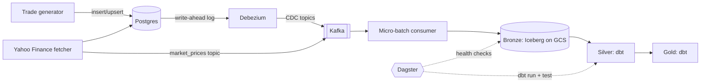

# Market Pulse

A real-time data pipeline for a simulated stock brokerage. Trades are captured from Postgres with change data capture, streamed through Kafka with live market prices, landed as Apache Iceberg tables on Google Cloud Storage, and modeled into portfolio analytics with dbt on BigQuery.

**Stack:** PostgreSQL · Debezium · Kafka · Apache Iceberg · GCS · BigQuery · dbt · Dagster · Docker

> Part of my portfolio at **[devanshi4.github.io](https://devanshi4.github.io)**

## Highlights

- **The stream can't drift from the database:** trades are captured with CDC (Debezium reading the Postgres log), not published by the app.
- **No lost trades, no double counts:** Kafka offsets are committed only after the Iceberg write succeeds, and silver removes any replays.
- **Every number is traceable:** each bronze row carries the exact Kafka topic, partition and offset it came from.

---

## The problem

A brokerage needs portfolio numbers (market value, profit and loss, trading activity) that stay close to real time. The trades live in an operational database that analytics shouldn't query directly. Kafka can deliver the same message twice, and the pipeline can't lose a trade or count one twice.

## How it works



1. **Source.** `fake_trades.py` places a random BUY or SELL across eight tickers every 3 seconds. Each trade and its position update commit in one transaction. `yahoo_fetcher.py` pulls the latest 1-minute price bar per ticker every 60 seconds.
2. **Change data capture.** Debezium reads the Postgres write-ahead log and publishes every change to `trades`, `positions` and `accounts` to Kafka.
3. **Bronze.** `kafka_to_iceberg_consumer.py` buffers messages per table and appends them to Iceberg in micro-batches: every 100 messages or 30 seconds.
4. **Silver.** dbt casts types, drops snapshot and delete events, and deduplicates.
5. **Gold.** dbt builds portfolio, trading, price and account-level analytics.
6. **Orchestration.** Dagster checks that bronze tables are filling up, then runs dbt models and tests on a schedule.

## Design decisions

- **CDC instead of publishing events from the app.** Debezium reads committed changes from the write-ahead log, so the Kafka stream can never drift from the database.
- **At-least-once delivery, deduplicated downstream.** Kafka offsets are committed only after a successful Iceberg write. A crash can replay a batch but never lose one, and silver deduplicates on `trade_id`.
- **Lineage on every row.** Bronze rows carry `_ingested_at`, `_kafka_topic`, `_kafka_partition`, `_kafka_offset` and `_cdc_op`, so any number can be traced to the exact message it came from.
- **Explicit schemas in bronze.** Iceberg tables are created with fixed schemas, and incoming fields are filtered to match, so an unexpected field upstream can't break a write. Prices stay as strings in bronze to keep exact decimals, and dbt casts them to `NUMERIC`.
- **No credentials in git.** The Debezium connector config only holds `${POSTGRES_*}` placeholders. The register script fills them from `.env` at registration time.
- **Partitioned for the common queries.** Trades and positions are partitioned by ingestion day, prices by day and ticker.

## Data model

| Model | Grain | What it answers |
|---|---|---|
| `silver_trades` / `silver_positions` / `silver_accounts` / `silver_market_prices` | one row per entity | Typed, cleaned, deduplicated source data |
| `gold_portfolio_summary` | account × ticker | Market value, amount invested, unrealized P&L and P&L % |
| `gold_trading_activity` | account × ticker | Buy and sell counts, shares traded, money spent and received |
| `gold_price_analytics` | ticker × day | Daily OHLCV, range, moving averages, day-over-day change |
| `gold_account_performance` | account | Overall return, best and worst position, rank |

dbt tests cover uniqueness, not-null and accepted values on tickers and trade types.

## Run it locally

You need Docker, Python 3.10+, a GCP project with a GCS bucket and BigQuery, a service account key, and a dbt profile named `market_pulse` pointing at BigQuery.

1. Create a `.env` file with the Postgres, Kafka and GCP settings (`POSTGRES_*`, `KAFKA_BOOTSTRAP_SERVERS`, `GCP_PROJECT_ID`, `GCS_BUCKET`, `GOOGLE_APPLICATION_CREDENTIALS`).
2. Install dependencies and start the services:

   ```bash
   pip install -r requirements.txt
   ```

   ```bash
   docker compose up -d
   ```

3. Register the Debezium connector (it reads the Postgres credentials from `.env`) and create the bronze tables. The setup script drops and recreates the tables.

   ```bash
   bash ingestion/register_connector.sh
   ```

   ```bash
   python ingestion/setup_iceberg_tables.py
   ```

4. In separate terminals, start the trade generator, the price fetcher and the consumer:

   ```bash
   python data_generators/fake_trades.py
   ```

   ```bash
   python -m data_generators.yahoo_fetcher
   ```

   ```bash
   python ingestion/kafka_to_iceberg_consumer.py
   ```

5. Check that bronze data landed, compile dbt, and start Dagster:

   ```bash
   python ingestion/validate_bronze.py
   ```

   ```bash
   cd dbt_project && dbt compile && cd .. && dagster dev
   ```

Kafka UI runs at http://localhost:8080 and Dagster at http://localhost:3000. BigQuery needs external tables over the Iceberg data on GCS (for example BigLake) before dbt can read the `bronze` dataset.

## Project structure

```
├── docker-compose.yml        # Postgres, Kafka (KRaft), Kafka Connect + Debezium, Kafka UI
├── init/01_schema.sql        # Source tables and 10 seed accounts
├── data_generators/          # Trade simulator, price fetcher, Kafka producer helper
├── ingestion/                # Connector setup, Iceberg tables, consumer, bronze checks
├── dbt_project/models/       # sources, silver, gold
└── orchestration/            # Dagster assets, jobs, schedules
```

## Status and next steps

- Compute daily open and close from the first and last bar of the day instead of min and max.
- Add freshness thresholds to the dbt sources.
- Run the consumer as a monitored service, with a dead-letter topic for messages it can't parse.
- Put a dashboard on top of the gold layer.

---

Built by **Devanshi Pandya** · [Portfolio](https://devanshi4.github.io) · [LinkedIn](https://www.linkedin.com/in/devanshi4/)
